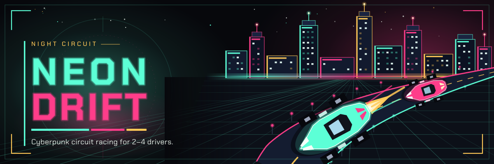

# Neon Drift

**Browser multiplayer racing** on a neon night circuit. **One player can start alone.** In a full room, **2–4 drivers** race neon cars, collect power-ups, and sabotage each other.

Drive with **WASD** until a wheel is attached. A **Wokwi** PSX gamepad or steering wheel can take over, and everyone meets on **one public server**.

**Play now:** [https://team3-game.codewithpeter.com](https://team3-game.codewithpeter.com)

**Race** · **Time Attack** · **Boost & EMP** · **Best-lap leaderboard**

## Play

The game is live at [https://team3-game.codewithpeter.com](https://team3-game.codewithpeter.com).

Open that address, pick a name, and create or join a room with the 4-letter code. One driver can start alone. With two or more, everyone presses Ready. Drive with WASD or the arrow keys. Space uses boost or EMP.

A laptop wheel bridge uses `GAME_SERVER_URL=wss://team3-game.codewithpeter.com`.

## Team
| Name | Role |
|------|------|
| Batuhan Mert Elma | Game server & networking |
| Muhsin Arsu | Game screen (Web client) |
| Rita Gadlela | Wokwi controllers, bridge & docs |

## Docs
- [Game concept](concept.md)
- [Game events](game_events.md)
- [Tech design](tech_design.md)

## How to run

The Dockerfile starts the game server and the leaderboard consumer. The server serves the game screen on the same port. Browsers and the Wokwi bridge connect there. Steering at 30 Hz stays on the WebSocket. Finished events (`room_joined`, `lap_completed`, `race_ended`, and the rest) are published to the course Redpanda broker when the broker variables below are set. A missing password or a failed POST is written to the log. The password is never committed.

The leaderboard consumer is a separate process in group `team3.leaderboard`. It reads `team3.events` and stores plausible `lap_completed` times. The game server does not write those rows itself.

**Port:** `8787`, unless `PORT` is set.

**Environment variables**

| Name | Required | Purpose |
|------|----------|---------|
| `PORT` | no | Listen port. Default `8787`. |
| `BROKER_URL` | for events | `https://edp-broker.codewithpeter.com` |
| `BROKER_USER` | for events | `team3` |
| `BROKER_PASSWORD` | for events | Team password from Slack. Set it on the server only. |
| `BROKER_TOPIC` | no | Default `team3.events`. |
| `BROKER_GROUP` | no | Consumer group. Default `team3.leaderboard`. Must start with `team3`. |
| `LEADERBOARD_PATH` | no | SQLite file for best laps. Shared by the server and the consumer. |
| `CLIENT_DIST` | no | Built game screen. The image uses `/app/client/dist`. |

```bash
docker build -t neon-drift .
docker run --rm -p 8787:8787 --env-file .env neon-drift
```

`.env` is the copy of `.env.example` with `BROKER_PASSWORD` filled in. It stays off git. Startup logs `Neon Drift listening on 8787`, `broker on` or `broker off`, and `leaderboard consumer group team3.leaderboard`. `GET /health` returns `{"ok":true}`. Players use https://team3-game.codewithpeter.com.

## Run locally

Wokwi controllers and the serial bridge are a separate piece. This repo runs the game without them: the browser sends the same `set_input` / `use_item` commands the bridge will send later.

```bash
npm install
cp .env.example .env   # optional; put BROKER_PASSWORD here, never commit .env
npm run dev
```

- Game screen: `http://localhost:5173`
- Game server: `ws://localhost:8787`

Press Ready to start. A race with one driver starts as soon as that driver is ready. A race with two or more waits until every driver is ready. Time Attack is solo. Drive with WASD or the arrow keys. Space uses a held boost or EMP. Shield and oil fire on pickup. `npm run dev` also starts the leaderboard consumer. Without `BROKER_PASSWORD` it logs that and exits. The game server keeps running.

## Wheel bridge

The ESP32 wheel lives in `controller/wheel` (Wokwi, serial on port 4000). `bridge/bridge.py` reads that serial port and drives the car.

1. Create or join a room in the browser and leave the tab open.
2. Copy the room code and your driver name into `bridge/.env` (`ROOM_CODE`, `PLAYER_ID`). `PLAYER_ID` is the name you typed, not a separate account.
3. Start the Wokwi simulation, then `pip install -r bridge/requirements.txt` and `python bridge/bridge.py`.

The bridge sends `connect_controller`, `drive_input` and `use_item`. Hits, boosts and the finish line come back as `controller_feedback` and the sketch flashes the LED and buzzes. Keyboard still works until the bridge is connected; after that the wheel owns the pedals.

The server publishes finished events (`room_joined`, `lap_completed`, `race_ended`, …) to the course Redpanda broker when `BROKER_URL`, `BROKER_USER` and `BROKER_PASSWORD` are set. Snapshots and session tokens stay off that topic. The leaderboard is filled by the consumer, not by the game loop. Wire format is `game_events.md`.
